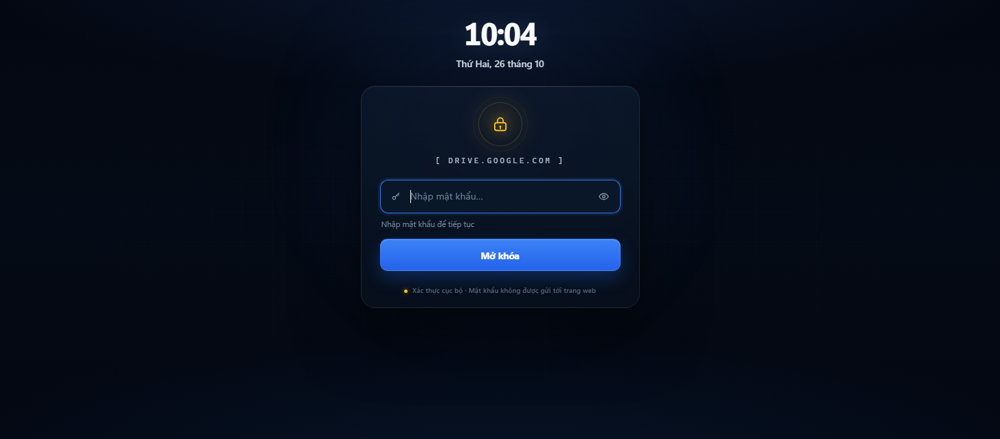
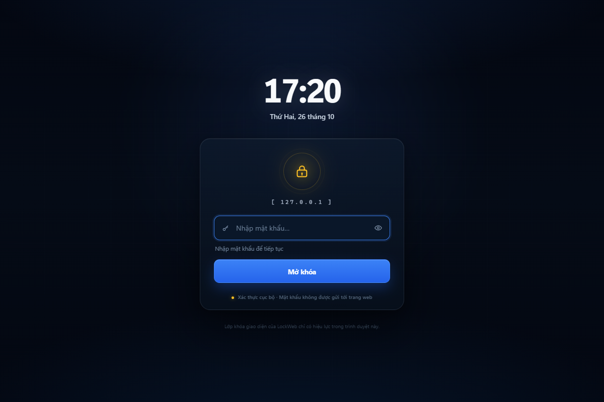
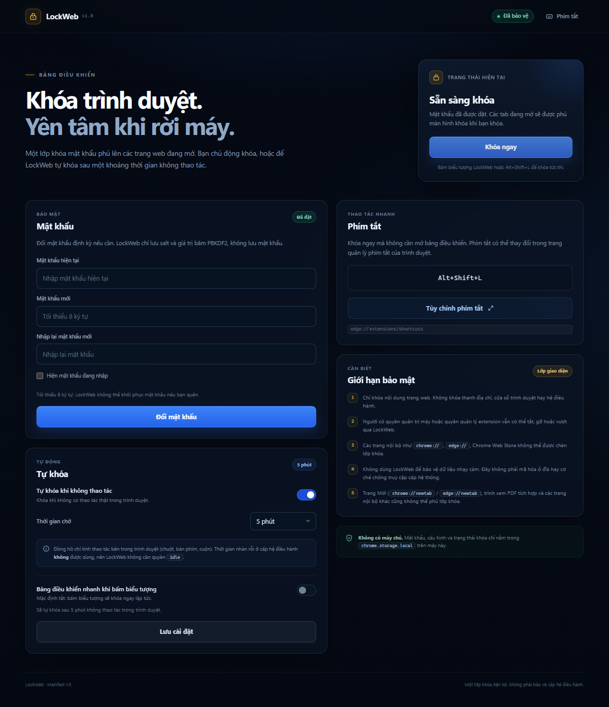

# LockWeb — Khóa màn hình trình duyệt (Manifest V3)

LockWeb là extension Chromium/Edge tạo một **lớp khóa giao diện** trên các tab web. Người dùng có thể khóa ngay bằng biểu tượng trên thanh công cụ hoặc phím tắt, hoặc để extension tự khóa sau một khoảng thời gian không thao tác trong trình duyệt. Mật khẩu chỉ được lưu dưới dạng salt + hash PBKDF2.

> **Đây là lớp khóa tiện lợi, không phải cơ chế bảo vệ dữ liệu nhạy cảm.** Extension không thể khóa thanh địa chỉ, cửa sổ trình duyệt hay hệ điều hành. Người có quyền quản trị máy vẫn có thể tắt/gỡ extension hoặc vượt qua. Xem [Giới hạn bảo mật](#giới-hạn-bảo-mật).



## Tính năng

- **Khóa ngay mặc định:** bấm biểu tượng LockWeb trên thanh công cụ là khóa ngay, không qua bước xác nhận.
- **Phím tắt tùy chỉnh:** mặc định `Alt+Shift+L` trên Windows/Linux, `Command+Shift+L` trên macOS. Có thể đổi trong trang quản lý phím tắt của trình duyệt.
- **Màn hình khóa tiếng Việt:** đồng hồ, ngày, tên miền, ô mật khẩu, nút hiện/ẩn, thông báo lỗi và thời gian tạm dừng.
- **Tự khóa:** bật/tắt và chọn 1–60 phút không thao tác trong trình duyệt.
- **Bền trạng thái:** giữ khóa khi chuyển tab, tải lại trang, mở tab mới hoặc khởi động lại trình duyệt.
- **Bảo vệ thao tác nhập:** mật khẩu được nhập trong iframe cùng origin extension, đặt trong closed Shadow DOM; trang web không đọc được giá trị hay sự kiện bàn phím của ô mật khẩu.
- **Chống thử mật khẩu dồn dập:** tối đa 5 lần sai, sau đó tạm dừng 30 giây; các lần thử được xử lý tuần tự.
- **Trang Cài đặt bị chặn khi đang khóa:** tự chuyển sang màn hình khóa, không để lộ phần cài đặt.
- **Không có backend, không telemetry:** mọi dữ liệu nằm trên máy.

## Cấu trúc dự án

```text
Lockweb/
├── manifest.json
├── background/
│   └── service-worker.js       # trạng thái, PBKDF2, rate limit, alarm, inject
├── content/
│   └── lock-content.js         # Shadow DOM + iframe, đồng bộ state, activity
├── lock/
│   ├── lock.html               # màn hình khóa (extension page)
│   ├── lock.css
│   └── lock.js
├── options/
│   ├── options.html
│   ├── options.css
│   └── options.js
├── popup/
│   ├── popup.html
│   ├── popup.css
│   └── popup.js
├── icons/
│   ├── icon16.png
│   ├── icon32.png
│   ├── icon48.png
│   └── icon128.png
├── docs/                       # ảnh xem trước
├── tests/
│   ├── service-worker.test.js  # unit test với Chrome API giả lập
│   ├── static-check.js         # kiểm tra manifest/ID/HTML
│   └── e2e.js                  # E2E bằng Playwright + Edge
├── tools/
│   └── make-icons.py
├── package.json
└── README.md
```

## Cài đặt thử trong chế độ Developer mode

### Chrome / Chromium

1. Mở `chrome://extensions`.
2. Bật **Developer mode** (góc trên bên phải).
3. Chọn **Load unpacked** và chọn thư mục gốc `Lockweb` (thư mục chứa `manifest.json`).
4. Ghim extension lên thanh công cụ.
5. Trang Cài đặt thường tự mở. Nếu không, bấm biểu tượng LockWeb → **Mở Cài đặt**, hoặc vào **Details → Extension options**.
6. Đặt mật khẩu tối thiểu 8 ký tự.
7. (Tùy chọn) Mở `chrome://extensions/shortcuts` để đổi phím tắt. Trong trang Cài đặt có nút **Tùy chỉnh phím tắt**.
8. (Tùy chọn) Trong **Details**, bật **Allow access to file URLs** nếu muốn khóa cả trang `file://`. Bật **Allow in Incognito** nếu dùng cửa sổ ẩn danh (mặc định extension không chạy ở đó).

### Microsoft Edge

Thay `chrome://extensions` bằng `edge://extensions`; phím tắt mặc định vẫn là `Alt+Shift+L`. Trang phím tắt là `edge://extensions/shortcuts`.

### Sau khi sửa mã

- Bấm **Reload** cho extension trong trang quản lý extension.
- Tải lại các tab đang mở để content script phiên bản mới được nạp.

## Cách dùng

- **Khóa ngay:** bấm biểu tượng LockWeb trên thanh công cụ (mặc định), hoặc nhấn `Alt+Shift+L`.
- **Mở khóa:** nhập mật khẩu trên màn hình khóa của tab. Nhấn `Enter` hoặc bấm **Mở khóa**.
- **Tự khóa:** bật trong Cài đặt và chọn thời gian chờ.
- **Bảng điều khiển nhanh:** bật **Bảng điều khiển nhanh khi bấm biểu tượng** trong Cài đặt nếu muốn bấm biểu tượng mở popup thay vì khóa ngay. Khi tắt (mặc định), biểu tượng khóa ngay lập tức.
- **Đổi mật khẩu:** Cài đặt → Mật khẩu → nhập mật khẩu hiện tại, mật khẩu mới, xác nhận.

Khi đã khóa, nếu mở trang Cài đặt hoặc popup, extension sẽ đưa về màn hình khóa/yêu cầu mở khóa trước. Không có chức năng khôi phục mật khẩu.

## Quyền và lý do xin quyền

| Quyền | Mục đích |
| --- | --- |
| `storage` | Lưu cấu hình, salt/hash, trạng thái khóa; `chrome.storage.session` lưu mốc hoạt động gần nhất và token hiển thị màn khóa. |
| `scripting` | Chèn lại content script vào các tab đã mở trước khi extension được cài/reload; bảo đảm tab cũ cũng bị phủ khi khóa. |
| `alarms` | Hẹn giờ tự khóa để vẫn hoạt động khi service worker bị Chromium tạm dừng. |
| `host_permissions: <all_urls>` | Cần để chèn lớp khóa và đọc trạng thái trên mọi trang web. Đây là quyền rộng; extension chỉ dùng để phủ màn hình khóa, theo dõi thao tác tin cậy và không đọc nội dung trang. |
| `commands` (manifest, không phải permission) | Khai báo phím tắt khóa; người dùng tùy chỉnh qua trình duyệt. |

**Không xin các quyền:** `tabs`, `idle`, `webNavigation`, `cookies`, `history`, `clipboardRead`, `debugger`, `management` hay quyền mạng. Vì không có `tabs`, extension không đọc/điều hướng được các URL nội bộ như `chrome://`; xem giới hạn bên dưới.

## Thiết kế bảo mật

### Mật khẩu và PBKDF2

- Salt ngẫu nhiên **16 byte** từ `crypto.getRandomValues`.
- PBKDF2-HMAC-**SHA-256**, **600.000 vòng**, đầu ra **256 bit**.
- Chỉ lưu `salt`, `hash`, `iterations`, `version`, `algorithm` trong `chrome.storage.local`:
  ```json
  {
    "version": 1,
    "algorithm": "PBKDF2-HMAC-SHA-256",
    "iterations": 600000,
    "salt": "base64...",
    "hash": "base64..."
  }
  ```
- Không lưu, không log, không gửi mật khẩu dạng văn bản ra ngoài extension.
- So sánh bằng vòng lặp XOR có thời gian không phụ thuộc vào nội dung (constant-time) sau khi derive.
- Mật khẩu được chuẩn hóa Unicode NFC trước khi derive để tránh khác biệt tổ hợp dấu tiếng Việt.

### Xác minh trong thành phần tin cậy

- Service worker là nơi duy nhất xác minh mật khẩu.
- Nội dung trang web **không nhận** mật khẩu. Ô nhập nằm trong `chrome-extension://.../lock/lock.html`, được nhúng trong iframe.
- Content script tạo **closed Shadow DOM** và gắn iframe vào đó. Trang web không truy cập được shadow root, iframe document hay value của input. Sự kiện bàn phím trong iframe cũng không nổi bọt sang document của trang.
- Mỗi tab có một **view token** ngẫu nhiên do content script đăng ký với service worker. Iframe gửi token khi lấy trạng thái/xác thực. Một trang web tự nhúng `lock.html` mà không có token sẽ nhận màn hình lỗi, không thấy form mật khẩu.
- Các thao tác nhạy cảm (`SET_PASSWORD`, `SET_SETTINGS`, `SUBMIT_PASSWORD`, `LOCK_NOW`) chỉ được chấp nhận từ extension page cùng origin; content script chỉ được gửi `ACTIVITY` và `REGISTER_VIEW`.
- Màn hình khóa chỉ được gỡ khi `lwLockState.isLocked` trong `chrome.storage.local` chuyển thành `false` — trạng thái do service worker ghi sau khi xác thực thành công.
- CSP của extension: `script-src 'self'; object-src 'none'; base-uri 'none'`; không có script từ xa.

### Chống thử mật khẩu

- 5 lần sai liên tiếp → tạm dừng 30 giây.
- Bộ đếm lưu trong `chrome.storage.local`, không reset khi tải lại trang.
- Các yêu cầu xác thực được **tuần tự hóa** trong service worker, tránh nhiều tab gửi song song để lách bộ đếm.
- Sau khi mở khóa thành công, bộ đếm và thời gian chờ được reset.

### Tự khóa: thời gian trong trình duyệt, không phải `chrome.idle`

- LockWeb **không dùng** API `chrome.idle`, nên không cần quyền `idle`.
- “Không thao tác” được đo bằng các sự kiện **isTrusted** trong các frame của trang: `pointerdown`, `keydown`, `wheel`, `touchstart`, `mousemove`; thêm chuyển tab (`tabs.onActivated`) và cửa sổ được focus (`windows.onFocusChanged`).
- Sự kiện do JavaScript của trang tự tạo (`isTrusted === false`) bị bỏ qua. Sự kiện `window.focus` cũng không được tính vì trang có thể gọi `window.focus()`.
- Mốc hoạt động gần nhất nằm trong `chrome.storage.session`. Khi service worker bị dừng rồi khởi động lại, mốc này vẫn còn; một alarm một lần được đặt ở `lastActivity + timeout`.
- Vì vậy, thời gian nhàn rỗi **của hệ điều hành** (ví dụ người dùng đang dùng ứng dụng khác) không được đo trực tiếp. Nếu máy ngủ và Chrome bị treo tiến trình, alarm sẽ được xử lý khi Chrome chạy lại và có thể khóa ngay. Đây là chủ ý: extension chỉ đo thao tác trong trình duyệt, không trộn với trạng thái idle toàn hệ thống.
- Khi service worker bị dừng, `chrome.alarms` và `chrome.storage` giữ vai trò nguồn sự thật; không có bộ đếm nào chỉ nằm trong RAM.

### Đồng bộ trạng thái

- Content script đọc `lwLockState` từ `chrome.storage.local` khi trang bắt đầu và lắng nghe `chrome.storage.onChanged`.
- Khi khóa, service worker ghi state trước, sau đó chèn content script vào mọi tab để các tab mở từ trước khi cài/reload cũng hiện lớp khóa.
- Khi mở khóa, state chuyển sang `false`; mọi content script tự gỡ iframe. Không cần gửi mật khẩu đến tab.
- Sau khi khởi động lại trình duyệt, `lwLockState.isLocked = true` vẫn còn trong `storage.local`; nội dung trang đọc lại state khi được khôi phục và khóa lại.

## Kiểm thử

### Kiểm thử tự động không cần trình duyệt

```bash
npm run test:unit
npm run test:static
# hoặc cả hai:
npm test
```

- `tests/service-worker.test.js` dùng Chrome API giả lập để kiểm tra: chưa có mật khẩu, đặt mật khẩu, xác thực sai/đúng, token iframe, giới hạn thử, alarm tự khóa, khóa lặp không reset bộ đếm, mất auth không để trạng thái mồ côi.
- `tests/static-check.js` kiểm tra manifest, tệp tồn tại, ID HTML được JS tham chiếu và không có script/event handler inline.

### E2E với Edge/Chromium

Yêu cầu: Node.js, `playwright-core`, Microsoft Edge (hoặc sửa `EDGE` trong `tests/e2e.js` thành Chrome/Chromium).

```bash
npm install
npm run test:e2e
```

E2E đã kiểm tra trên Edge 156:

- đặt mật khẩu, khóa từ trang Cài đặt;
- màn hình khóa xuất hiện trên tab đang mở;
- sai mật khẩu hiển thị lỗi và bộ đếm;
- đúng mật khẩu gỡ lớp khóa;
- tải lại trang khi khóa vẫn hiện màn hình khóa;
- mở tab mới tới một website khi khóa vẫn hiện màn hình khóa;
- chuyển tab giữ nguyên lớp khóa;
- iframe extension vẫn tải trên trang có `frame-src 'none'`;
- mở Cài đặt khi khóa bị chuyển sang màn hình khóa;
- khởi động lại trình duyệt vẫn giữ khóa;
- đổi mật khẩu, mật khẩu cũ không còn hiệu lực, mật khẩu mới mở khóa được.

Ảnh chụp thực tế:





## Giới hạn bảo mật

Đọc kỹ phần này trước khi dùng cho bất kỳ mục đích nào ngoài việc khóa giao diện tạm thời.

1. **Chỉ là lớp khóa giao diện.** LockWeb không khóa được thanh địa chỉ, menu, DevTools, cửa sổ trình duyệt, desktop hay ổ đĩa. Người dùng vẫn có thể chuyển ứng dụng, dùng Task Manager, hoặc mở trình duyệt khác.
2. **Quản trị viên có thể tắt/gỡ extension.** Người có quyền cài đặt trình duyệt, sửa profile, tắt extension, gỡ extension, chạy DevTools hoặc can thiệp file hệ thống có thể vượt qua. Không có cơ chế chống gỡ.
3. **Trang nội bộ không thể phủ.** Chromium không cho content script chạy trên `chrome://*`, `edge://*`, Chrome Web Store, trang quản lý extension, trình xem PDF tích hợp, trang Mới (`chrome://newtab` / `edge://newtab`) và một số trang được bảo vệ khác. Khi mở các trang này, không có màn hình khóa. Khi từ đó điều hướng tới một website thường, lớp khóa sẽ xuất hiện.
4. **Trang web có thể can thiệp vào DOM.** Closed Shadow DOM và iframe bảo vệ việc nhập mật khẩu khỏi việc đọc trực tiếp, nhưng một trang độc hại vẫn có thể cố gỡ/che host, dùng top layer, hoặc lừa người dùng theo cách khác. Không nên tin tưởng lớp khóa này trước một trang web độc hại.
5. **Hash có thể bị brute-force offline.** PBKDF2 làm chậm việc đoán, nhưng nếu kẻ tấn công đọc được `chrome.storage.local`, họ có thể thử mật khẩu ngoài extension. Mật khẩu yếu làm giảm đáng kể hiệu quả.
6. **Không mã hóa dữ liệu.** LockWeb không mã hóa nội dung trang, ổ đĩa, cookie hay dữ liệu cá nhân. Nó không thay thế mã hóa ổ đĩa, khóa màn hình hệ điều hành hay quản lý quyền truy cập.
7. **Không có khôi phục mật khẩu.** Nếu quên mật khẩu, cách duy nhất là gỡ extension (xóa toàn bộ cấu hình) và cài lại. Không có câu hỏi bảo mật hay email khôi phục.
8. **Profile/cửa sổ riêng biệt.** Extension không bảo vệ cửa sổ ẩn danh nếu chưa bật “Allow in Incognito”, profile trình duyệt khác, trình duyệt khác hoặc tài khoản OS khác.
9. **Không dành cho dữ liệu nhạy cảm.** Không quảng bá hoặc sử dụng LockWeb như biện pháp bảo vệ dữ liệu nhạy cảm, bảo mật y tế/tài chính, hay kiểm soát truy cập thiết bị.

## Xử lý sự cố

| Hiện tượng | Cách xử lý |
| --- | --- |
| Bấm biểu tượng không khóa, mở Cài đặt | Chưa có mật khẩu. Đặt mật khẩu trước. |
| Không thấy lớp khóa trên một trang | Tải lại trang; kiểm tra đó có phải trang nội bộ (`chrome://`, Web Store, PDF, New Tab) hay không. |
| Trang `file://` không khóa | Bật **Allow access to file URLs** trong phần Details của extension. |
| Phím tắt không hoạt động | Mở `chrome://extensions/shortcuts` / `edge://extensions/shortcuts`, kiểm tra xung đột và gán lại. |
| Sau khi cập nhật extension, trang cũ không khóa | Tải lại trang cũ để nạp content script mới. |
| Quên mật khẩu | Gỡ extension; dữ liệu cục bộ sẽ bị xóa. |
| Trang chặn iframe đặc biệt | Extension hiển thị lớp cảnh báo thay vì form mật khẩu; chuyển sang tab khác để mở khóa. |

## Quyền riêng tư

- Không có máy chủ, không có analytics, không gọi mạng.
- Không đọc nội dung trang để gửi đi; content script chỉ theo dõi sự kiện thao tác tin cậy và dựng lớp phủ.
- Mật khẩu chỉ đi qua IPC nội bộ của extension tới service worker.
- Gỡ extension sẽ xóa `chrome.storage.local` của extension.

## Miễn trừ trách nhiệm

Mã nguồn được cung cấp cho mục đích học tập và sử dụng cá nhân. Hãy tự đánh giá, kiểm tra và chịu trách nhiệm trước khi triển khai cho người khác. LockWeb không phải sản phẩm bảo mật cấp doanh nghiệp và không nên là biện pháp duy nhất để bảo vệ dữ liệu.
# LockWeb

