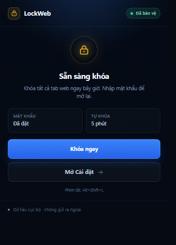
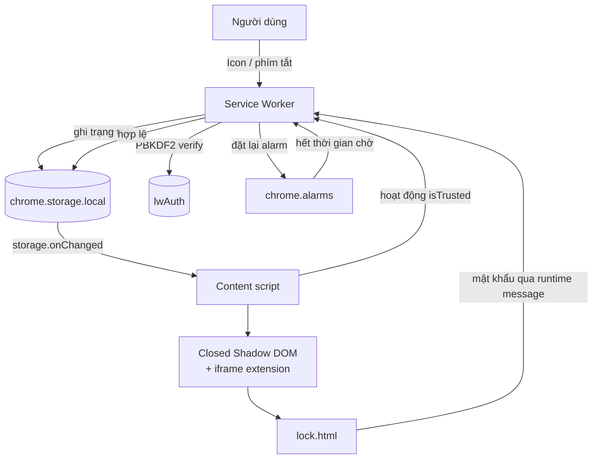

<p align="center">
  
</p>

<h1 align="center">LockWeb</h1>

<p align="center">
  <strong>Khóa màn hình trình duyệt bằng mật khẩu — nhanh, gọn, cục bộ.</strong><br>
  Extension Manifest V3 cho Chromium / Microsoft Edge.
</p>

<p align="center">
  
  
  
  
  
  
</p>

<p align="center">
  <a href="#install">Cài đặt</a> ·
  <a href="#features">Tính năng</a> ·
  <a href="#security">Bảo mật</a> ·
  <a href="#testing">Kiểm thử</a> ·
  <a href="#limitations">Giới hạn</a>
</p>

> [!WARNING]
> **LockWeb chỉ tạo một lớp khóa giao diện.** Extension không thể khóa thanh địa chỉ, DevTools, cửa sổ trình duyệt hay hệ điều hành. Người có quyền quản trị máy vẫn có thể tắt/gỡ extension, dùng profile khác hoặc vượt qua theo nhiều cách. **Không dùng LockWeb làm biện pháp duy nhất để bảo vệ dữ liệu nhạy cảm.**


## Mục lục

- [Giới thiệu](#about)
- [Ảnh giao diện](#screenshots)
- [Tính năng](#features)
- [Cài đặt](#install)
- [Cách sử dụng](#usage)
- [Quyền được yêu cầu](#permissions)
- [Kiến trúc](#architecture)
- [Thiết kế bảo mật](#security)
- [Kiểm thử](#testing)
- [Giới hạn bảo mật](#limitations)
- [Câu hỏi thường gặp](#faq)
- [Quyền riêng tư](#privacy)
- [Cấu trúc dự án](#project-structure)
- [Đóng góp](#contributing)
- [Giấy phép và miễn trừ](#license)

<a id="about"></a>
## Giới thiệu

LockWeb phủ một màn hình khóa lên các tab web đang mở và các tab được mở sau đó. Người dùng khóa bằng biểu tượng trên thanh công cụ hoặc phím tắt, hoặc để extension tự khóa sau một khoảng thời gian không thao tác bên trong trình duyệt.

Mật khẩu **không được lưu dưới dạng văn bản**. Extension tạo salt ngẫu nhiên và lưu giá trị xác minh PBKDF2-HMAC-SHA-256 trong `chrome.storage.local`. Việc xác minh diễn ra bên trong service worker của extension; trang web không nhận được mật khẩu.

- **Không backend, không telemetry, không gọi mạng.**
- **Không build step:** nạp trực tiếp thư mục dự án bằng `Load unpacked`.
- **Manifest V3:** service worker, content scripts, Shadow DOM và Chrome Extension APIs.

<a id="screenshots"></a>
## Ảnh giao diện

| Màn hình khóa thực tế | Trang Cài đặt |
| :---: | :---: |
|  |  |

<p align="center">
  
  <br>
  <sub>Bảng điều khiển nhanh — chỉ mở khi bật tùy chọn tương ứng.</sub>
</p>

<a id="features"></a>
## Tính năng

- **Khóa ngay mặc định** — bấm biểu tượng LockWeb trên thanh công cụ là khóa ngay, không qua bước xác nhận.
- **Phím tắt tùy chỉnh** — mặc định <kbd>Alt</kbd> + <kbd>Shift</kbd> + <kbd>L</kbd> trên Windows/Linux và <kbd>Command</kbd> + <kbd>Shift</kbd> + <kbd>L</kbd> trên macOS. Có thể đổi trong trang quản lý phím tắt.
- **Màn hình khóa tiếng Việt** — đồng hồ, ngày, tên miền, ô mật khẩu, nút hiện/ẩn, thông báo lỗi và đếm ngược thời gian tạm dừng.
- **Tự khóa linh hoạt** — bật/tắt và chọn thời gian chờ 1–60 phút không thao tác trong trình duyệt.
- **Bền trạng thái** — giữ khóa khi chuyển tab, tải lại trang, mở tab mới hoặc khởi động lại trình duyệt.
- **Cô lập mật khẩu** — ô nhập nằm trong iframe extension, đặt trong closed Shadow DOM; trang web không đọc được value hoặc sự kiện bàn phím của ô mật khẩu.
- **Chống thử mật khẩu dồn dập** — tối đa 5 lần sai, tạm dừng 30 giây; các lần xác thực được xử lý tuần tự.
- **Chặn Cài đặt khi khóa** — trang Options tự chuyển về màn hình khóa, không để lộ phần cấu hình.
- **Bảng điều khiển nhanh tùy chọn** — nếu muốn, biểu tượng có thể mở popup thay vì khóa ngay.
- **Dữ liệu cục bộ** — không có máy chủ, không có analytics, không gửi mật khẩu ra ngoài extension.

<a id="install"></a>
## Cài đặt

### Yêu cầu

- Chromium **109+** hoặc Microsoft Edge tương đương.
- Không cần Node.js để chạy extension. Node.js chỉ cần cho việc chạy test.

### Cách 1 — Dùng bản đóng gói

1. Tải hoặc clone repository này.
2. Giải nén [`dist/LockWeb-1.0.0.zip`](dist/LockWeb-1.0.0.zip) (hoặc dùng trực tiếp thư mục dự án).
3. Mở `chrome://extensions` hoặc `edge://extensions`.
4. Bật **Developer mode**.
5. Chọn **Load unpacked** và trỏ tới thư mục có chứa `manifest.json`.
6. Ghim LockWeb lên thanh công cụ.

### Cách 2 — Từ mã nguồn

```bash
git clone <repository-url>
cd LockWeb
```

Sau đó làm theo bước 3–6 ở trên. Không cần chạy `npm install` để sử dụng extension.

### Sau khi cài

1. Trang Cài đặt thường tự mở. Nếu không, bấm biểu tượng LockWeb → **Mở Cài đặt**.
2. Đặt mật khẩu tối thiểu **8 ký tự**.
3. (Tùy chọn) Đổi phím tắt tại `chrome://extensions/shortcuts` hoặc `edge://extensions/shortcuts`.
4. (Tùy chọn) Bật **Allow access to file URLs** nếu muốn khóa trang `file://`.
5. (Tùy chọn) Bật **Allow in Incognito** nếu dùng cửa sổ ẩn danh.

> [!NOTE]
> Extension chưa được phát hành trên Chrome Web Store. Cách cài hiện tại là **Developer mode / Load unpacked**.

### Sau khi sửa mã

- Bấm **Reload** cho extension trong trang quản lý extension.
- Tải lại các tab đang mở để nạp content script mới.

<a id="usage"></a>
## Cách sử dụng

| Thao tác | Cách thực hiện |
| --- | --- |
| Khóa ngay | Bấm biểu tượng LockWeb, hoặc nhấn `Alt+Shift+L` / `Command+Shift+L` |
| Mở khóa | Nhập mật khẩu trên màn hình khóa của tab, nhấn `Enter` hoặc bấm **Mở khóa** |
| Tự khóa | Cài đặt → **Tự khóa** → bật và chọn thời gian chờ |
| Đổi mật khẩu | Cài đặt → **Mật khẩu** → nhập mật khẩu hiện tại, mật khẩu mới và xác nhận |
| Mở bảng điều khiển nhanh | Bật **Bảng điều khiển nhanh khi bấm biểu tượng** trong Cài đặt |
| Tùy chỉnh phím tắt | Cài đặt → **Phím tắt** → **Tùy chỉnh phím tắt** |

Khi đã khóa, trang Cài đặt và popup đều không cho thay đổi cấu hình trước khi mở khóa. Không có chức năng khôi phục mật khẩu.

<a id="permissions"></a>
## Quyền được yêu cầu

| Quyền | Mục đích | Ghi chú |
| --- | --- | --- |
| `storage` | Lưu salt/hash, cấu hình, trạng thái khóa, token tạm và mốc hoạt động | Dữ liệu nằm cục bộ |
| `scripting` | Chèn lại content script vào các tab mở trước khi extension được cài/reload | Bảo đảm tab cũ cũng bị phủ khi khóa |
| `alarms` | Hẹn giờ tự khóa | Hoạt động khi service worker bị Chromium tạm dừng |
| `host_permissions: <all_urls>` | Phủ màn hình khóa và theo dõi thao tác trên các trang web | Quyền rộng, cần thiết cho mục đích của extension |

**Không yêu cầu:** `tabs`, `idle`, `webNavigation`, `cookies`, `history`, `clipboardRead`, `debugger`, `management` hay quyền mạng.

`commands` là khai báo phím tắt trong manifest, không phải một permission. Vì không xin quyền `tabs`, extension không đọc/điều hướng được các URL nội bộ như `chrome://`; xem [Giới hạn bảo mật](#limitations).

<a id="architecture"></a>
## Kiến trúc



### Thành phần

- `background/service-worker.js` — máy trạng thái, PBKDF2, rate limit, alarm, token hiển thị và inject content script.
- `content/lock-content.js` — đọc trạng thái, dựng host trong closed Shadow DOM, nhúng iframe khóa, đồng bộ khi state thay đổi và gửi tín hiệu hoạt động.
- `lock/lock.html|css|js` — giao diện màn hình khóa, xác thực mật khẩu và hiển thị lỗi.
- `options/` — đặt/đổi mật khẩu, cấu hình tự khóa, bảng điều khiển nhanh và phím tắt.
- `popup/` — bảng điều khiển nhanh tùy chọn.
- `icons/` — icon extension.

### Dữ liệu lưu trữ

| Khóa | Nơi lưu | Nội dung |
| --- | --- | --- |
| `lwAuth` | `storage.local` | `version`, `algorithm`, `iterations`, `salt`, `hash`, `createdAt` |
| `lwSettings` | `storage.local` | `autoLockEnabled`, `idleMinutes`, `openPanelOnIcon` |
| `lwLockState` | `storage.local` | `isLocked`, `lockedAt`, `reason`, `unlockedAt` |
| `lwAttempts` | `storage.local` | `count`, `blockedUntil` |
| `lwLastActivityAt` | `storage.session` | Mốc hoạt động gần nhất |
| `lwViewTokens` | `storage.session` | Token iframe theo tab |

Không có trường nào chứa mật khẩu dạng văn bản.

<a id="security"></a>
## Thiết kế bảo mật

### Mật khẩu và PBKDF2

- Salt ngẫu nhiên **16 byte** từ `crypto.getRandomValues`.
- **PBKDF2-HMAC-SHA-256**, **600.000 vòng**, đầu ra **256 bit**.
- Mật khẩu được chuẩn hóa Unicode NFC trước khi derive.
- Chỉ lưu salt, hash, iterations, version và algorithm. Không lưu, không log, không gửi mật khẩu dạng văn bản.
- So sánh hash bằng vòng lặp XOR constant-time sau khi derive.

### Cô lập mật khẩu khỏi trang web

- Ô mật khẩu nằm trong `chrome-extension://.../lock/lock.html`, được nhúng trong iframe.
- Content script tạo **closed Shadow DOM** để trang web không truy cập được shadow root, iframe document hoặc value của input.
- Sự kiện bàn phím trong iframe không nổi bọt sang document của trang.
- Mỗi tab có một **view token** ngẫu nhiên. Nếu một trang web tự nhúng `lock.html` mà không có token hợp lệ, extension hiển thị màn hình lỗi thay vì form mật khẩu.
- Các thao tác nhạy cảm (`SET_PASSWORD`, `SET_SETTINGS`, `SUBMIT_PASSWORD`, `LOCK_NOW`) chỉ được chấp nhận từ extension page cùng origin.
- Màn hình khóa chỉ được gỡ khi `lwLockState.isLocked` chuyển thành `false`, do service worker ghi sau khi xác thực thành công.
- CSP extension: `script-src 'self'; object-src 'none'; base-uri 'none'`.

### Chống thử mật khẩu

- 5 lần sai liên tiếp → tạm dừng 30 giây.
- Bộ đếm lưu trong `chrome.storage.local`, không reset khi tải lại trang.
- Các yêu cầu xác thực được tuần tự hóa trong service worker để nhiều tab không thể thử song song nhằm lách bộ đếm.
- Bộ đếm và thời gian chờ được reset sau khi mở khóa thành công.

### Tự khóa: thời gian trong trình duyệt, không phải `chrome.idle`

- LockWeb **không dùng** `chrome.idle`, nên không cần quyền `idle`.
- “Không thao tác” được đo bằng sự kiện **isTrusted** trong các frame: `pointerdown`, `keydown`, `wheel`, `touchstart`, `mousemove`; thêm chuyển tab (`tabs.onActivated`) và cửa sổ được focus (`windows.onFocusChanged`).
- Sự kiện do JavaScript của trang tạo ra (`isTrusted === false`) bị bỏ qua. Sự kiện `window.focus` cũng không được tính vì trang có thể gọi `window.focus()`.
- Mốc hoạt động nằm trong `chrome.storage.session`; alarm một lần được đặt ở `lastActivity + timeout`.
- Khi service worker bị dừng, `chrome.alarms` và `chrome.storage` là nguồn sự thật; không có bộ đếm nào chỉ nằm trong RAM.
- **Phân biệt rõ:** đây là thời gian không thao tác **trong trình duyệt**, không phải thời gian nhàn rỗi toàn hệ điều hành. Nếu máy ngủ trong lúc Chrome vẫn chạy, alarm có thể khóa ngay khi Chrome xử lý lại.

<a id="testing"></a>
## Kiểm thử

### Unit và static check

```bash
npm test
```

hoặc chạy riêng:

```bash
npm run test:unit
npm run test:static
```

- `tests/service-worker.test.js` — Chrome API giả lập: đặt mật khẩu, xác thực sai/đúng, token iframe, rate limit, alarm tự khóa, khóa lặp không reset bộ đếm, mất auth không để trạng thái mồ côi.
- `tests/static-check.js` — kiểm tra manifest, tệp tồn tại, ID HTML được JS tham chiếu và không có script/event handler inline.

### E2E với Edge / Chromium

Yêu cầu: Node.js, `playwright-core` và Microsoft Edge (hoặc sửa `EDGE` trong `tests/e2e.js` thành Chrome/Chromium).

```bash
npm install
npm run test:e2e
```

E2E đã chạy trên **Edge 156**:

| Kịch bản | Kết quả |
| --- | :---: |
| Đặt mật khẩu và khóa từ trang Cài đặt | ✅ |
| Màn hình khóa trên tab đang mở | ✅ |
| Sai mật khẩu hiển thị lỗi và bộ đếm | ✅ |
| Đúng mật khẩu gỡ lớp khóa | ✅ |
| Tải lại trang khi đang khóa | ✅ |
| Mở tab mới tới website khi đang khóa | ✅ |
| Chuyển tab giữ nguyên lớp khóa | ✅ |
| Trang có CSP `frame-src 'none'` | ✅ |
| Mở Cài đặt khi đang khóa bị chặn | ✅ |
| Khởi động lại trình duyệt vẫn khóa | ✅ |
| Đổi mật khẩu, mật khẩu cũ hết hiệu lực | ✅ |
| Mật khẩu mới mở khóa được | ✅ |

> [!NOTE]
> E2E chạy bằng Edge ở chế độ headless trên Windows và cần quyền khởi chạy tiến trình trình duyệt trong môi trường test.

<a id="limitations"></a>
## Giới hạn bảo mật

> [!CAUTION]
> LockWeb **không phải** giải pháp bảo vệ dữ liệu nhạy cảm. Đây là lớp khóa giao diện tiện lợi, có thể bị vượt qua bởi người có quyền truy cập máy hoặc quyền quản lý trình duyệt.

1. **Không khóa được hệ điều hành.** Thanh địa chỉ, menu, DevTools, desktop, Task Manager và các ứng dụng khác vẫn truy cập được.
2. **Quản trị viên có thể tắt/gỡ extension.** Người có quyền sửa profile, chạy DevTools, tắt extension hoặc can thiệp file hệ thống có thể vượt qua. Không có cơ chế chống gỡ.
3. **Trang nội bộ không thể phủ.** Chromium không cho content script chạy trên `chrome://*`, `edge://*`, Chrome Web Store, trang quản lý extension, trình xem PDF tích hợp, trang Mới (`chrome://newtab` / `edge://newtab`) và một số trang được bảo vệ khác.
4. **Tab Mới nội bộ không hiển thị màn hình khóa.** Khi mở một website trong tab đó, lớp khóa sẽ xuất hiện; trước đó, trang Mới vẫn là giao diện của trình duyệt.
5. **Trang web có thể can thiệp DOM.** Closed Shadow DOM và iframe bảo vệ việc nhập mật khẩu khỏi việc đọc trực tiếp, nhưng trang độc hại vẫn có thể cố che/gỡ host hoặc dùng top layer. Không nên tin tưởng lớp khóa này trước một trang web độc hại.
6. **Hash có thể bị brute-force offline.** PBKDF2 làm chậm việc đoán, nhưng nếu kẻ tấn công đọc được `chrome.storage.local`, họ có thể thử mật khẩu ngoài extension.
7. **Không mã hóa dữ liệu.** LockWeb không mã hóa nội dung trang, ổ đĩa, cookie hay dữ liệu cá nhân. Nó không thay thế mã hóa ổ đĩa hay khóa màn hình hệ điều hành.
8. **Không có khôi phục mật khẩu.** Nếu quên, cách duy nhất là gỡ extension (xóa toàn bộ cấu hình) và cài lại.
9. **Phạm vi profile.** Extension không bảo vệ cửa sổ ẩn danh nếu chưa bật “Allow in Incognito”, profile trình duyệt khác, trình duyệt khác hoặc tài khoản OS khác.

<a id="faq"></a>
## Câu hỏi thường gặp

<details>
<summary><strong>Tôi quên mật khẩu thì phải làm sao?</strong></summary>

Không có cơ chế khôi phục. Hãy gỡ extension và cài lại; toàn bộ cấu hình trong `chrome.storage.local` sẽ bị xóa. Đây là lựa chọn thiết kế để không tạo backdoor khôi phục.
</details>

<details>
<summary><strong>Vì sao mở tab mới hoặc chrome://extensions không thấy màn hình khóa?</strong></summary>

Đó là các trang nội bộ/trang được bảo vệ của trình duyệt. Chromium không cho content script chèn vào. Khi mở một website thông thường trong tab đó, màn hình khóa sẽ xuất hiện.
</details>

<details>
<summary><strong>Mật khẩu có được gửi lên mạng không?</strong></summary>

Không. Mật khẩu chỉ được nhập trong extension page và gửi qua IPC nội bộ của extension tới service worker để xác minh. Extension không có backend và không thực hiện network request.
</details>

<details>
<summary><strong>Tại sao không dùng API chrome.idle?</strong></summary>

`chrome.idle` đo trạng thái nhàn rỗi toàn hệ điều hành. LockWeb chủ động đo thao tác bên trong trình duyệt để phân biệt rõ hai khái niệm và không cần thêm quyền `idle`. Xem phần [Tự khóa](#security).
</details>

<details>
<summary><strong>Đây có phải công cụ bảo vệ dữ liệu nhạy cảm?</strong></summary>

Không. LockWeb chỉ là lớp khóa giao diện, không mã hóa dữ liệu và không chống được quản trị viên, malware, keylogger cấp hệ điều hành hay người có quyền truy cập máy.
</details>

<a id="privacy"></a>
## Quyền riêng tư

- Không có máy chủ, không có analytics, không gọi mạng.
- Không gửi nội dung trang, lịch sử duyệt web hoặc mật khẩu ra ngoài extension.
- Content script chỉ dựng lớp phủ, theo dõi sự kiện thao tác tin cậy và đọc trạng thái khóa; không thu thập nội dung trang.
- Gỡ extension sẽ xóa `chrome.storage.local` của extension.
- Mật khẩu được xử lý trong bộ nhớ service worker trong thời gian ngắn để derive hash và không được ghi xuống storage.

<a id="project-structure"></a>
## Cấu trúc dự án

```text
LockWeb/
├── manifest.json
├── background/
│   └── service-worker.js       # trạng thái, PBKDF2, rate limit, alarm, inject
├── content/
│   └── lock-content.js         # Shadow DOM + iframe, đồng bộ state, activity
├── lock/
│   ├── lock.html               # màn hình khóa (extension page)
│   ├── lock.css
│   └── lock.js
├── options/
│   ├── options.html
│   ├── options.css
│   └── options.js
├── popup/
│   ├── popup.html
│   ├── popup.css
│   └── popup.js
├── icons/
│   ├── icon16.png
│   ├── icon32.png
│   ├── icon48.png
│   └── icon128.png
├── docs/                       # ảnh xem trước
├── tests/
│   ├── service-worker.test.js  # unit test với Chrome API giả lập
│   ├── static-check.js         # kiểm tra manifest/ID/HTML
│   └── e2e.js                  # E2E bằng Playwright + Edge
├── tools/
│   └── make-icons.py
├── dist/
│   └── LockWeb-1.0.0.zip
├── .gitignore
├── package.json
└── README.md
```

<a id="contributing"></a>
## Đóng góp

1. Fork repository và tạo branch mới.
2. Giữ thay đổi tập trung, không thêm remote script hoặc quyền không cần thiết.
3. Chạy `npm test` trước khi gửi pull request.
4. Nếu sửa UI hoặc luồng khóa, chạy thêm `npm install && npm run test:e2e`.
5. Không đính kèm mật khẩu thật, dữ liệu cá nhân hoặc ảnh chụp thông tin nhạy cảm vào issue/PR.

Nếu phát hiện vấn đề bảo mật, hãy mô tả kỹ điều kiện tái hiện nhưng **không công khai mật khẩu hay dữ liệu thật**.

<a id="license"></a>
## Giấy phép và miễn trừ

Repository hiện **chưa kèm tệp `LICENSE`**. Trước khi phân phối lại hoặc đưa lên Chrome Web Store, hãy thêm giấy phép phù hợp với mục đích của bạn.

Mã nguồn được cung cấp cho mục đích học tập và sử dụng cá nhân. Hãy tự đánh giá, kiểm tra và chịu trách nhiệm trước khi triển khai cho người khác. LockWeb không phải sản phẩm bảo mật cấp doanh nghiệp và không nên là biện pháp duy nhất để bảo vệ dữ liệu.

---

<p align="center">
  <sub>LockWeb 1.0.0 · Manifest V3 · Made for Chromium</sub>
</p>
